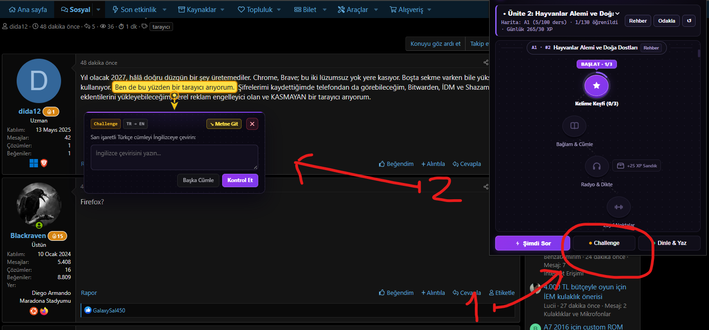
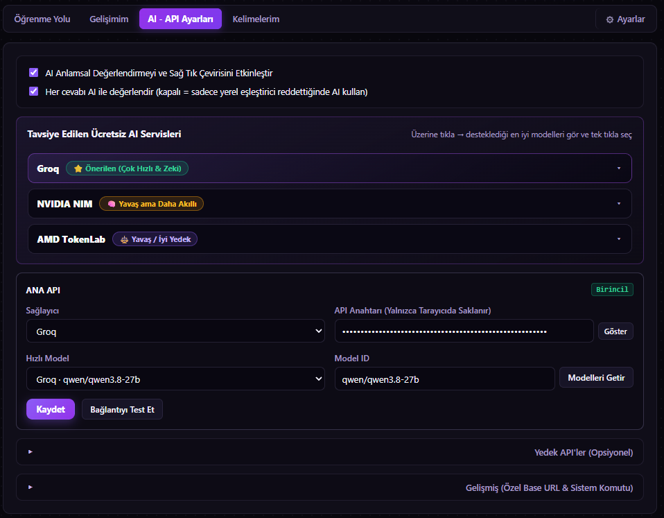

**Language / Dil:** [🇹🇷 Türkçe](README.md) · 🇬🇧 **English**

# ⚡ EasyLang

**Learn English effortlessly while browsing with free AI coaching — not just rote flashcards, but smart feedback that helps you truly improve.**

EasyLang is a browser extension for Chrome, Edge, and Brave built around **AI-powered language growth**. Instead of forcing you into a separate study app, it turns everyday web browsing into simple practice that adapts to your mistakes.

<p align="center">
  
</p>

---

## 🤖 Why AI-Powered Growth?

Traditional flashcards only say "right" or "wrong" and expect exact memorization. With EasyLang, AI acts like a personal tutor:

- **Checks meaning, not just exact words:** When you use a valid synonym, AI accepts your answer and explains why in simple terms.
- **Catches weak spots automatically:** If you slip on a tense or subtle nuance, AI saves that rule to your focus list and checks you again a few questions later until it sticks.
- **Personal AI Study Coach:** Reviews your accuracy and weak topics inside your progress dashboard and tells you what to focus on next.
- **Saves your API quota:** Exact matches are approved instantly on your device without calling AI, so your free quota is used only when helpful.

---

## 👀 How It Works

### 1. Learning Path & Quick Modes
Open the extension menu to follow topic-based lessons step by step, or jump straight into **Ask Now**, **Challenge**, or **Listen & Type** from the bottom bar.

- If you start as a beginner (`A1–A2`), questions stay approachable until you build a solid base, then EasyLang asks when you feel ready to move up.

---

### 2. Live Webpage Practice (`Challenge`)
Turn any article, forum thread, or blog post you are reading into a quick translation exercise:

1. Click **Challenge** in the popup *(or press `Alt+Shift+P`)*.
2. EasyLang picks a natural sentence on the page, highlights it in yellow, and points an arrow straight to your answer box.
3. Type your translation and get instant AI feedback.

<p align="center">
  
</p>

---

### 3. Smart Feedback & Automatic Mistake Tracking
EasyLang combines instant offline speed with deep AI explanations:

| Instant Check *(0 AI Quota)* | Meaning-Based AI Approval | AI Grammar & Focus Tracking |
| :---: | :---: | :---: |
|  |  |  |
| Standard correct answers are approved right on your device without using API quota. | Natural phrasing and valid synonyms are accepted with clear feedback. | Subtle grammar gaps are explained and scheduled for follow-up checks (`+2 → +4 → +10`). |

---

### 4. Progress & AI Study Coach (`My Progress`)
See your level, accuracy rate, strongest topics, and hardest words in one place. Use the **AI Study Coach** at the bottom whenever you want tailored next steps.

<p align="center">
  
</p>

---

### 5. Easy Free AI Setup (`AI - API Keys`)
Adding your own free AI key takes about a minute. A built-in guide walks you through creating a key step by step:

- **Groq** — *⭐ Recommended (Ultra-Fast & Smart)*
- **NVIDIA NIM** — *🧠 Slower but Deeper Reasoning*
- **AMD TokenLab** — *⚖️ Slower / Solid Backup*

You can also add optional backup APIs so EasyLang switches automatically if one provider hits a limit.

<p align="center">
  
</p>

---

## ✨ More Helpful Details

- **Listen & Type (`Alt+Shift+L`):** Hear English sentences at normal or slower speed and type what you hear.
- **Smart Review Timing:** Missed cards come back in 20 minutes; mastered ones wait longer between reviews.
- **Site Blocking:** Turn EasyLang off on banking, exam, or work sites in 1 click.
- **12 Languages:** Automatically detects your browser language on first use; UI and AI explanations support 12 languages.
- **Custom Words & Safe Backups:** Add your own words or sentences in Settings and export your progress anytime *(API keys are never included in backups)*.

---

## 📦 Installation (Chrome / Edge / Brave)

1. Download this repository, install dependencies, and build:
   ```bash
   npm install
   npm run build
   ```
2. Open `chrome://extensions` *(or `edge://extensions`)*.
3. Turn on **Developer mode** in the top-right corner.
4. Click **Load unpacked** and select the generated `dist` folder.

---

## 🔒 Privacy

- No personal data, analytics trackers, or hardcoded API keys exist anywhere in this repository.
- Your API keys and learning history stay inside your browser and are only sent to the AI provider you set up.

<details>
<summary>🛠 Developer Commands & Data Credits</summary>

```bash
npm run typecheck   # Run TypeScript checks
npm test            # Run unit tests (42 tests)
npm run build       # Build extension into dist/
npm run watch       # Rebuild automatically on file changes
```

*(Optional)* Rebuild the card dataset:

```bash
npm run build:data
npm run build
```

See [ATTRIBUTIONS.md](ATTRIBUTIONS.md) for open-source dataset credits and licenses.

</details>
