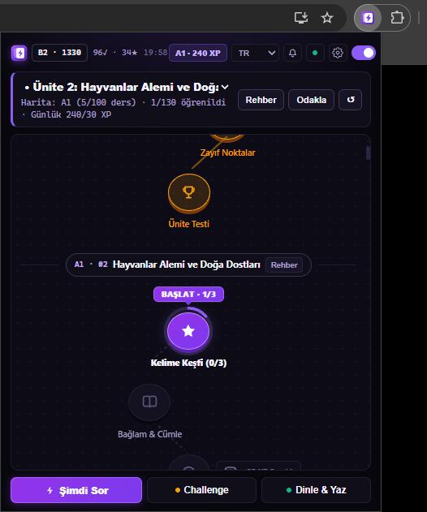
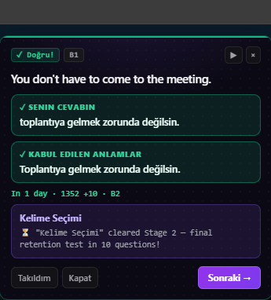
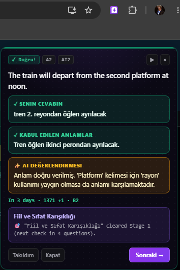
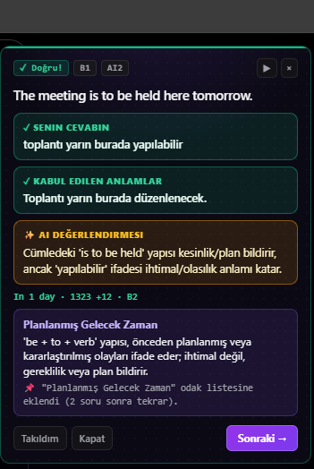
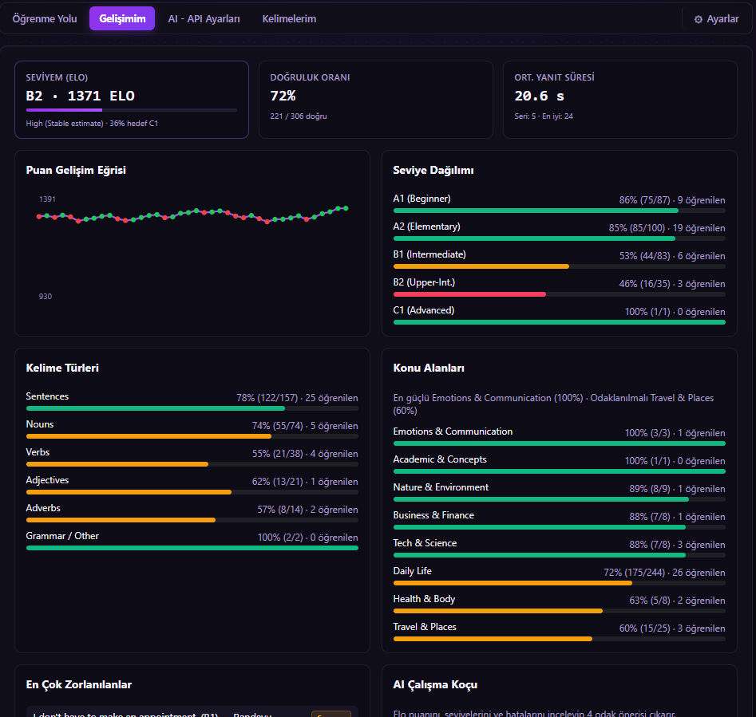

**Language / Dil:** [🇹🇷 Türkçe](README.md) · 🇬🇧 **English**

# ⚡ EasyLang - AI-Powered

**No need to pay for another language app.**
**No need to open study websites every day.**

A free, **AI-powered** browser extension that pops up while you browse and makes sure you actually learn English!

<p align="center">
  
</p>

---

## 🤖 How AI Helps You Grow

- **Meaning over memorization:** You do not have to match one exact dictionary word. If your translation means the same thing, AI accepts it.
- **Never forgets your mistakes:** AI catches small errors, explains why in simple words, and tests you again later until you get it right.
- **Free AI coach:** Watches where you are strong or weak and helps you improve step by step.

---

## 📸 See It in Action

### Translate Right on Any Page (`Challenge`)
Pick a sentence from any article or forum you are reading and type your answer right there.

<p align="center">
  
</p>

---

### Smart AI Feedback
| Instant Pass | Understands Your Words | Catches Mistakes & Retests |
| :---: | :---: | :---: |
|  |  |  |
| Exact answers pass immediately. | Accepts different words that mean the same thing. | Explains small mistakes and asks again a few cards later. |

---

### Track Your Progress & AI Coach
See your level, accuracy, and personal tips from your AI Study Coach.

<p align="center">
  
</p>

---

### Free AI Setup in 1 Minute
Connect a free key from **Groq**, **NVIDIA**, or **AMD**. Don't know how? Built-in steps walk you through it.

<p align="center">
  
</p>

---

## 📦 Install (Chrome / Edge / Brave)

1. Download this repo and run:
   ```bash
   npm install
   npm run build
   ```
2. Open `chrome://extensions` and turn on **Developer mode** (top right).
3. Click **Load unpacked** and select the `dist` folder.

<details>
<summary>Info: Privacy & Credits</summary>

- Your progress and API keys stay strictly inside your browser.
- Dataset credits: [ATTRIBUTIONS.md](ATTRIBUTIONS.md)

</details>
