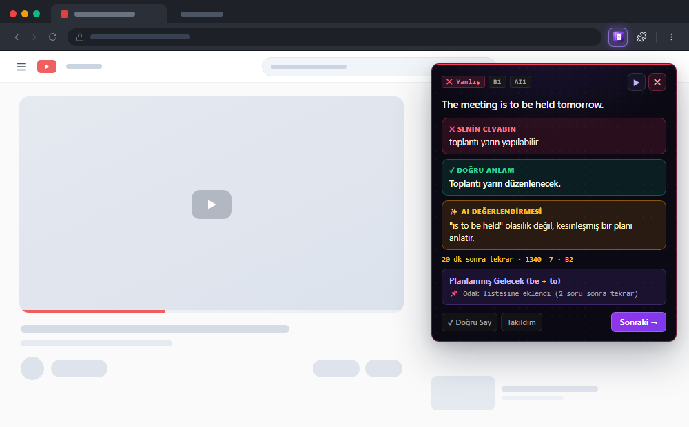
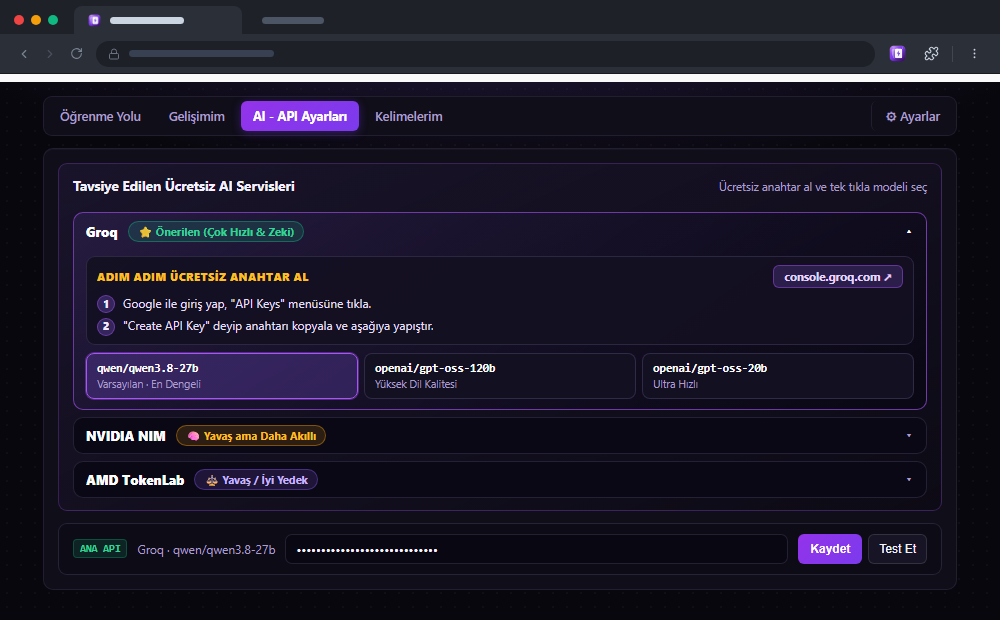

**Language / Dil:** [🇹🇷 Türkçe](README.md) · 🇬🇧 **English**

# ⚡ EasyLang - AI-Powered

**No need to pay for another language app.**
**No need to open study websites every day.**

A free, **AI-powered** browser extension that pops up while you browse and makes sure you actually learn English!

<p align="center">
  
</p>

> Open from the top right anytime — continue quick lessons or launch **Ask Now**, **Challenge**, and **Listen & Type** in one click.

---

## 🤖 AI That Understands Your Meaning

Browse Instagram or read articles as usual — even when you use different words, AI understands your meaning and accepts it.

<p align="center">
  
</p>

---

## 🎯 Catches Mistakes, Explains Why & Retests

When you slip up while watching videos or reading, AI explains the mistake in simple words, saves the rule, and tests you again later.

<p align="center">
  
</p>

---

## ✍️ Practice Right on Any Page (`Challenge`)

Highlight a sentence on any webpage in one click and translate it straight inside the box.

<p align="center">
  
</p>

---

## 📈 Track Your Progress & AI Coach

Follow your level, accuracy rate, and personalized **AI Study Coach** tips in one place.

<p align="center">
  
</p>

---

## ⚡ Free AI Setup in 1 Minute

Connect a free key from **Groq**, **NVIDIA**, or **AMD**. Built-in steps show you exactly how.

<p align="center">
  
</p>

---

## 📦 Install (Chrome / Edge / Brave)

1. Download `EasyLang-v1.0.0.zip` from **[Releases](https://github.com/gitcodeci19/easylang/releases/latest)** and unzip it.
2. Open `chrome://extensions` and turn on **Developer mode** (top right).
3. Click **Load unpacked** and select the unzipped folder.

<details>
<summary>Build from Source & Privacy</summary>

```bash
npm install
npm run build
```

- Your progress and API keys stay strictly inside your browser.
- Dataset credits: [ATTRIBUTIONS.md](ATTRIBUTIONS.md)

</details>

---

## 👨‍💻 Contributors

- **Idea & Product Direction:** **Orange Head** ([@gitcodeci19](https://github.com/gitcodeci19))
- **Code & Development:** **Antigravity** *(Google DeepMind AI)*
