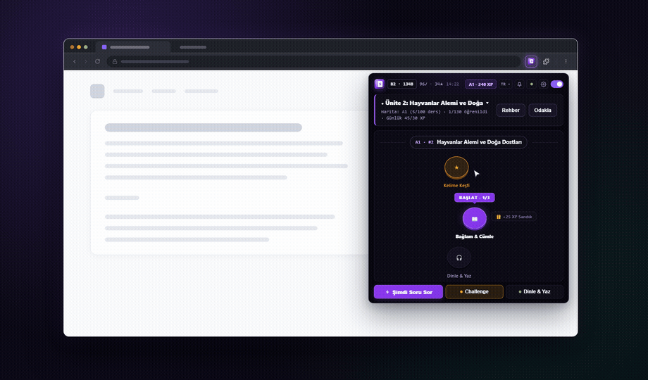

**Language / Dil:** [🇹🇷 Türkçe](README.md) · 🇬🇧 **English**

# ⚡ EasyLang - AI-Powered

<p align="left">
  <a href="https://github.com/gitcodeci19/easylang/releases">
    
  </a>
  <a href="https://github.com/gitcodeci19/easylang/releases/latest">
    
  </a>
  <a href="https://github.com/gitcodeci19/easylang/stargazers">
    
  </a>
</p>

**No need to pay for another language app.**
**No need to open study websites every day.**

A free, **AI-powered** browser extension that pops up while you browse and makes sure you actually learn English!

<p align="center">
  
</p>

> Even if you don't open the extension, a question tailored to your target level appears every **20 minutes**. No rote memorization: AI recognizes your meaning even when you rephrase.

---

## 🎯 Catches Mistakes, Explains Why & Schedules Focus Reviews

When you slip up while watching videos or reading, AI explains the mistake in simple words, pins that grammar rule to your focus list, and tests you again shortly after.

<p align="center">
  
</p>

---

## ✍️ Extension Menu & Instant Page `Challenge`

Jump into the skill roadmap from the popup anytime, or launch **Challenge** in one click to translate a highlighted sentence right on any webpage.

<p align="center">
  
</p>

---

## 📈 Progress Analytics, AI Coach & 1-Minute Free Setup

Track your Elo curve, accuracy, and **AI Study Coach** feedback — and connect a free key from **Groq**, **NVIDIA**, or **AMD** in about a minute.

<p align="center">
  
</p>

---

## 📦 Install (Chrome / Edge / Brave)

1. Download `EasyLang-v1.0.2.zip` from **[Releases](https://github.com/gitcodeci19/easylang/releases/latest)** and unzip it.
2. Open `chrome://extensions` and turn on **Developer mode** (top right).
3. Click **Load unpacked** and select the unzipped folder.

<details>
<summary>Build from Source & Privacy</summary>

```bash
npm install
npm run build
```

- Your progress and API keys stay strictly inside your browser.
- Dataset credits: [ATTRIBUTIONS.md](ATTRIBUTIONS.md)

</details>

---

## 🎬 Full Walkthrough Video *(Turkish Audio)*

https://github.com/user-attachments/assets/8c34cede-0d40-493f-ba9c-981a12020011

---

## 👨‍💻 Contributors

- **Idea & Product Direction:** **Orange Head** ([@gitcodeci19](https://github.com/gitcodeci19))
- **Code & Development:** **Antigravity** *(Google DeepMind AI)*
