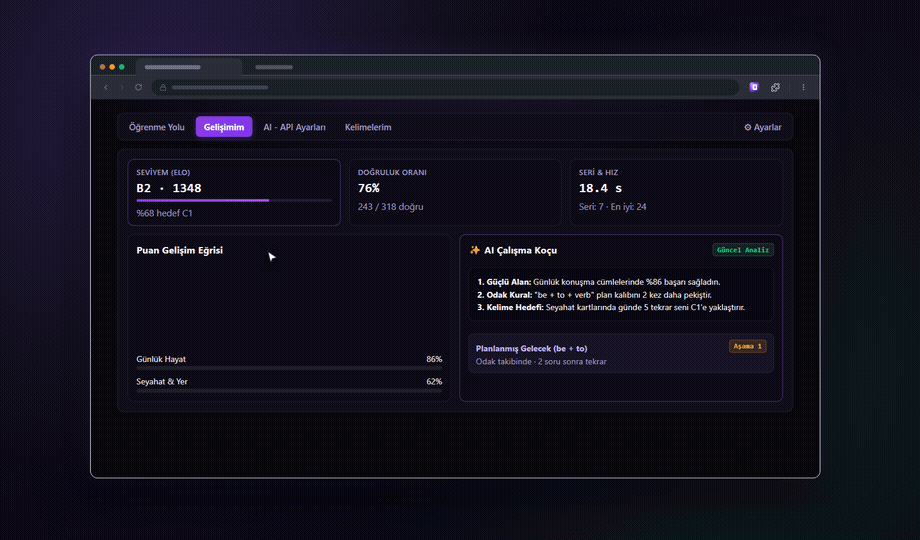

İngilizce Öğrenebileceğin Yapay Zeka Destekli Tarayıcı Eklentisi

https://github.com/user-attachments/assets/8c34cede-0d40-493f-ba9c-981a12020011

---

Siz normal internette gezerken karşınıza çıkıp **size zorla İngilizce öğreten**, **yapay zeka destekli** ücretsiz tarayıcı eklentisi!

<p align="center">
  
</p>

---

## 🎯 Hatanı Yakalar, Açıklar ve Odak Listesine Alır

Video izlerken bile önüne gelen soruda küçük bir hata yaptığında yapay zekâ nedenini sade bir dille anlatır, kuralı odak listesine alır ve biraz sonra yeniden sorup hafızana kazır.

<p align="center">
  
</p>

---

## ✍️ Sağ Üst Menüden Ders Yolu & Canlı `Challenge`

İstediğin an sağ üstteki menüden ders yoluna devam et ya da okuduğun herhangi bir web sayfasında tek tıkla **Challenge** başlatıp sayfadaki cümleyi anında çevir.

<p align="center">
  
</p>

---

## 📈 Gelişim Paneli, AI Koçu & 1 Dakikada Ücretsiz Kurulum

Doğruluk oranını, Elo seviyeni ve **AI Çalışma Koçu** önerilerini takip et; **Groq**, **NVIDIA** veya **AMD** üzerinden 1 dakikada ücretsiz API anahtarı alıp bağla.

<p align="center">
  
</p>

---

## 📦 Nasıl Kurulur? (Chrome / Edge / Brave)

1. **[Releases](https://github.com/gitcodeci19/easylang/releases/latest)** sayfasından hazır `EasyLang-v1.0.0.zip` dosyasını indir ve bir klasöre çıkart.
2. Tarayıcıda `chrome://extensions` aç, sağ üstten **Geliştirici modu**nu aç.
3. **Paketlenmemiş öğe yükle** de ve çıkarttığın klasörü seç.

<details>
<summary>Kaynak Koddan Derleme & Gizlilik</summary>

```bash
npm install
npm run build
```

- Tüm bilgilerin ve API anahtarın sadece kendi tarayıcında kalır.
- Veri kaynakları: [ATTRIBUTIONS.md](ATTRIBUTIONS.md)

</details>

## 👨‍💻 Geliştiriciler

- **Fikir & Ürün Yönetimi:** **Orange Head** ([@gitcodeci19](https://github.com/gitcodeci19))
- **Kodlama & Geliştirme:** **Antigravity** *(Google DeepMind AI)*
