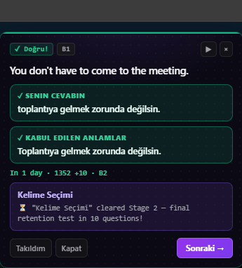
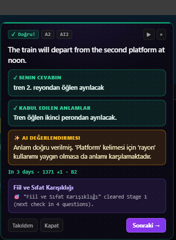
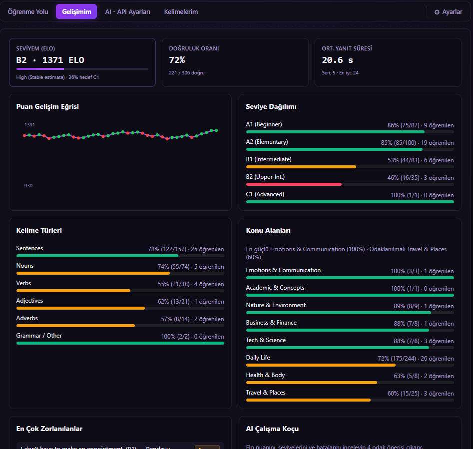

# ⚡ EasyLang

**Learn English effortlessly while browsing — zero burnout, smart spaced repetition, live webpage challenges, and optional free AI coaching.**

**EasyLang** is a privacy-first Manifest V3 browser extension for Chrome, Edge, and Brave. Instead of forcing you into a separate flashcard app, it weaves active recall directly into your daily browsing with a guided CEFR learning path, live webpage translation challenges, audio dictation, and semantic AI feedback.

<p align="center">
  
</p>

---

## ✨ Visual Tour

### 1. Guided Learning Path & Quick Modes
Open EasyLang from the toolbar to continue thematic CEFR units (`Animals`, `Sports`, `Cinema`, daily foundations) broken into **3 progressive steps per lesson**, or launch **Quick Quiz**, **Challenge**, and **Listen & Type** right from the bottom bar.

- **Two Independent Systems:** Unit **XP** tracks your structured curriculum path, while **Elo (`600–2000`)** measures live recall & challenge accuracy—keeping them separate prevents easy lesson XP from inflating your true CEFR estimate.
- **First-Run Guardrail:** Beginners choosing `A1` or `A2` start safely capped at `A1–A2` prompts until reaching `1100+ Elo`, when EasyLang asks whether you feel ready to unlock `B1`.

---

### 2. Live Webpage `Challenge` Mode (`Alt+Shift+P`)
Turn any article, forum thread, or blog post you are reading into an instant translation exercise:

1. Click **Challenge** in the popup (or press `Alt+Shift+P`).
2. EasyLang scans the page locally (**0 AI tokens spent scanning**), selects a natural English or Turkish sentence, highlights it brightly in yellow, and points a dynamic SVG arrow between the text and your answer box.

<p align="center">
  
</p>

---

### 3. Zero-Token Local Grading + Smart AI Semantic Feedback
EasyLang never wastes your API quota when a standard match already works—and shines whenever your wording differs from the textbook answer:

| Exact Local Match *(0 AI Tokens)* | Semantic Paraphrase Grading *(AI)* | Grammar Nuance & Focus Tracker *(+2 → +4 → +10)* |
| :---: | :---: | :---: |
|  |  |  |
| Instant offline verification with Turkish diacritic normalization & typo tolerance. | Accepts natural synonyms (*e.g., "reyon" vs "peron"*) and highlights feedback in color-coded bubbles. | Catches subtle tense/structure slips (*e.g., `be + to + verb`*) and schedules targeted follow-ups (`+2 → +4 → +10`). |

---

### 4. Progress & Elo Analytics (`My Progress`)
Track your rating trajectory curve, CEFR band mastery (`A1–C1`), part-of-speech accuracy, semantic topic strengths (`Emotions`, `Business`, `Tech`, `Travel`, etc.), tricky cards, and an on-demand **AI Study Coach**.

<p align="center">
  
</p>

---

### 5. Built-in Free AI Guide & Failover (`AI - API Keys`)
Includes a curated recommendation drawer with step-by-step free API setup instructions and top picks (**≤ 7 curated models per provider**) for:
- **Groq** — *⭐ Recommended (Ultra-Fast & Smart)*
- **NVIDIA NIM** — *🧠 Slower but Deeper Reasoning*
- **AMD TokenLab** — *⚖️ Slower / Solid Free Backup*

Configure a **Primary API** plus optional **Backup APIs (`AI2` & `AI3`)** for automatic failover on timeouts or rate limits (`429`).

<p align="center">
  
</p>

---

## 🚀 Key Features Summary

- **Listen & Type (`Alt+Shift+L`):** Direct `1.0x` / `0.75x` voice dictation (and optional live blurred YouTube caption practice) with word-by-word diff grading.
- **20-Minute Priority Retry + Spaced Repetition (SRS):** Missed cards return in 20 minutes; mastered cards expand (`1d → 3d → 7d → ... → 90d`).
- **Site Exclusion (Anti-Ban):** Exclude banking, exam, or work domains with zero `content.js` injection (`chrome.scripting`), or toggle any site in 1 click from the popup.
- **12 UI & Explanation Languages:** `Auto`, `Türkçe`, `English`, `Français`, `Español`, `Deutsch`, `日本語`, `Português`, `Русский`, `Italiano`, `한국어`, `中文`, and `العربية`.
- **Custom Decks & Safe Backups:** Add words/sentences right inside Settings, bulk import/export TSV/CSV/JSON, and download full `.json` progress backups (**API keys are strictly excluded from backup files**).

---

## 📦 Installation (Chrome / Edge / Brave)

1. Clone this repository, install dependencies, and build into `dist/`:
   ```bash
   npm install
   npm run build
   ```
2. Open `chrome://extensions` (or `edge://extensions`).
3. Enable **Developer mode** in the top-right corner.
4. Click **Load unpacked** and select the generated `dist/` folder.

---

## 🔒 Privacy & Security

- **Zero Hardcoded Keys or Telemetry:** No personal data, analytics trackers, or API keys exist anywhere in this repository.
- **100% Local Storage:** API keys, card history, and custom decks stay exclusively inside your browser's `chrome.storage.local` and are sent only to the AI endpoint you explicitly configure.

---

## 🛠 Development

```bash
npm run typecheck   # Run TypeScript type checks
npm test            # Run unit tests (42 passing via Node native runner)
npm run build       # Bundle extension into dist/
npm run watch       # Rebuild automatically on file changes
```

*(Optional)* Regenerate `public/data/cards.json` from upstream open datasets:
```bash
npm run build:data
npm run build
```

See [ATTRIBUTIONS.md](ATTRIBUTIONS.md) for dataset licenses and credits.
