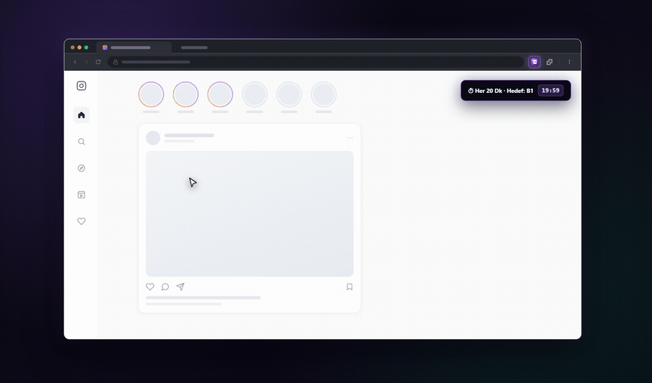
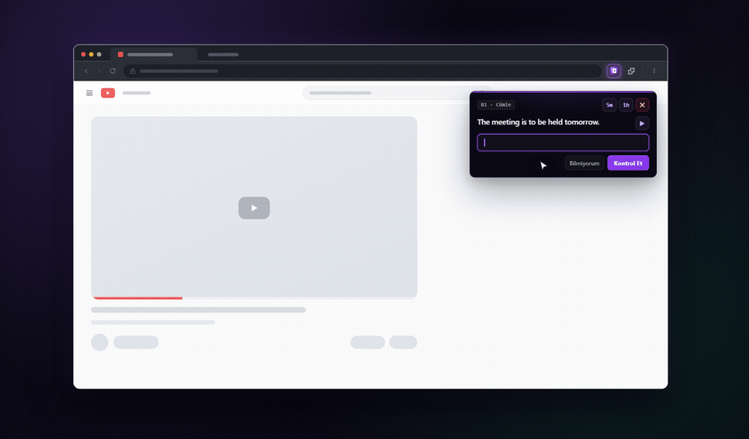

# EasyLang – Yapay Zekâ Destekli Dil Öğrenme Tarayıcı Eklentisi

### 🚀 EKLENTİ NELER YAPABİLİYOR?

- Tarayıcınızda herhangi bir sekmede Duolingo benzeri interaktif İngilizce dersleri yapabilirsiniz.
- Yapay zekâ hatalarınızı ve doğrularınızı analiz ederek eksiklerinize odaklanan kişisel dersler oluşturur.
- Tarayıcınız açık olduğu sürece her 20 dakikada bir karşınıza çıkarak sizi soru çözmeye teşvik eder.

---

<p align="center">
  
</p>

<p align="center">
  
</p>

https://github.com/user-attachments/assets/8c34cede-0d40-493f-ba9c-981a12020011

---

## 🤖 NASIL OLUYOR DA YAPAY ZEKÂ OLMASINA RAĞMEN BEDAVA?

Groq, NVIDIA ve AMD gibi şirketler, geliştiricilerin kullanabilmesi için ücretsiz API erişimi sunuyor. Bu sayede kendi bilgisayarınızda güçlü bir yapay zekâ çalıştırmanıza gerek kalmadan bu servislerden yararlanabiliyorsunuz.

## 🔑 Ücretsiz AI API Anahtarı Alma

**Sadece bir API anahtarı almanız yeterli.**

<details>
<summary><strong>🟢 Groq – Önerilen (Hızlı ve Akıllı) (TIKLAYIN)</strong></summary>

  **Tavsiye edilen model:** Qwen 3.8 27B

[Groq API Keys Sayfasını Aç ↗](https://console.groq.com/keys)

1. [console.groq.com](https://console.groq.com) adresine git ve Google veya e-posta ile ücretsiz kayıt ol.
2. Sağ üstteki **Create API Key** butonuna tıkla ve bir isim belirle (ör. EasyLang).
3. Oluşturulan `gsk_...` ile başlayan API anahtarını kopyala.
4. Anahtarı eklentideki **ANA API** alanına yapıştır, kaydet ve bağlantıyı test et.

</details>

<details>
<summary><strong>🔵 NVIDIA – Alternatif API</strong></summary>

[NVIDIA Build Sayfasını Aç ↗](https://build.nvidia.com/)

1. [build.nvidia.com](https://build.nvidia.com/) adresine git ve ücretsiz NVIDIA Developer hesabınla giriş yap.
2. Katalogdan kullanmak istediğin bir modeli (ör. Gemma 4 31B) seç.
3. **Get API Key** ve ardından **Generate API Key** butonlarına tıkla.
4. `nvapi-...` ile başlayan anahtarı kopyala.
5. Anahtarı eklentideki **ANA API** veya **Yedek API** alanına yapıştır, kaydet ve test et.

> Ücretsiz geliştirici kredileriyle güçlü modellere erişim sağlar. Kullanım koşulları ve ücretsiz kotalar değişebilir.

</details>

<details>
<summary><strong>🟠 AMD – Alternatif API</strong></summary>

[AMD Developer Portalını Aç ↗](https://developer.amd.com/ai-developer-program/)

1. [AMD Developer Portal](https://developer.amd.com/ai-developer-program/) adresine git ve **Join / Log In** üzerinden ücretsiz kayıt ol.
2. Giriş yaptıktan sonra **Token Lab (Radeon Cloud)** bölümünü aç.
3. **Get API Key** butonuna tıklayarak API anahtarını al.
4. Anahtarı eklentideki **ANA API** veya **Yedek API 1** alanına yapıştır, kaydet ve test et.

> AMD'nin bulut tabanlı AI modellerine erişim sağlar.

</details>

---

## 📦 Nasıl Kurulur? (Chrome / Edge / Brave)

1. **[Releases](https://github.com/gitcodeci19/easylang/releases/latest)** sayfasından hazır `EasyLang-v1.0.0.zip` dosyasını indir ve bir klasöre çıkart.
2. Tarayıcıda `chrome://extensions` adresini aç ve sağ üstten **Geliştirici modu**nu etkinleştir.
3. **Paketlenmemiş öğe yükle** butonuna tıkla ve çıkarttığın klasörü seç.

<details>
<summary><strong>🛠️ Kaynak Koddan Derleme & Gizlilik</strong></summary>

Projeyi kaynak koddan derlemek için:

```bash
npm install
npm run build
```

- API anahtarınız eklentinin yerel tarayıcı depolamasında saklanır.
- Yapay zekâ istekleri, seçtiğiniz API sağlayıcısına gönderilir.
- Kullanılan açık kaynaklar ve lisans bilgileri: [ATTRIBUTIONS.md](ATTRIBUTIONS.md)

</details>
