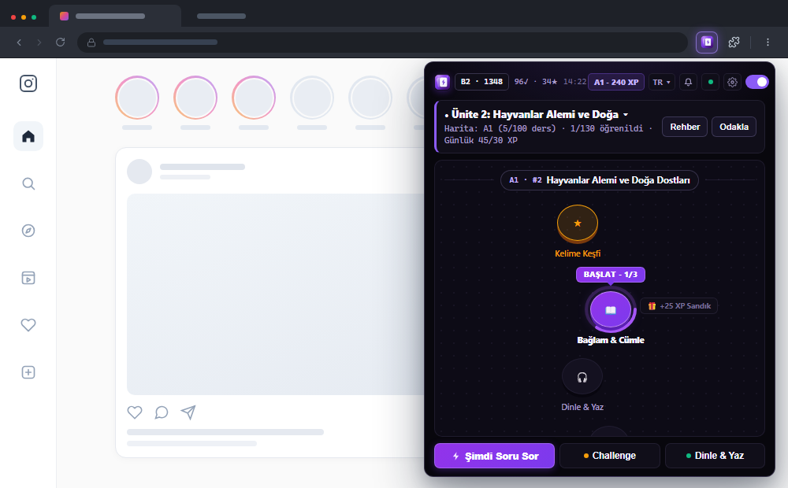
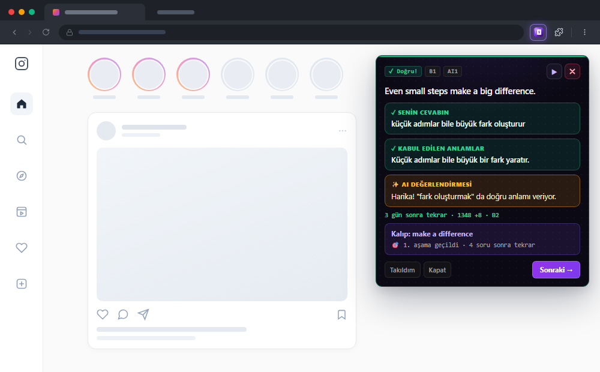
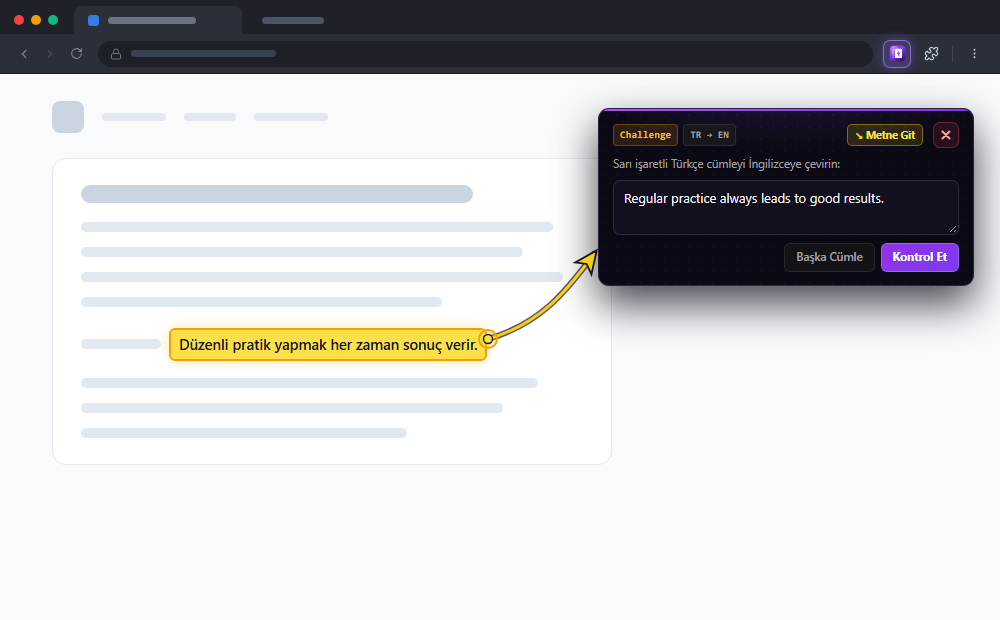
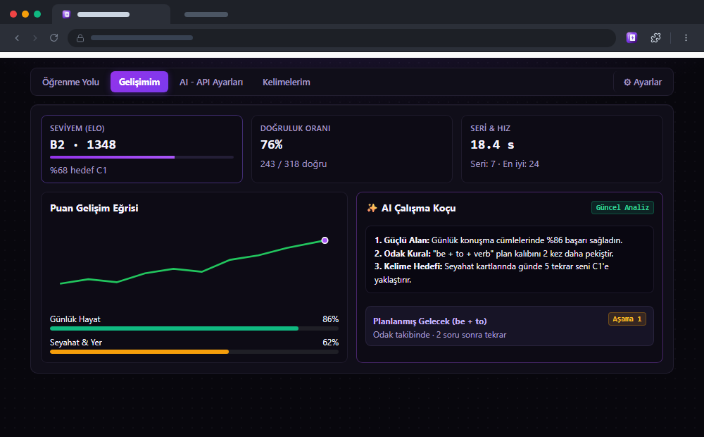

**Dil / Language:** 🇹🇷 **Türkçe** · [🇬🇧 English](README.en.md)

# EasyLang - Yapay Zeka Destekli

**Başka uygulamalara para vermeye gerek yok.**
**İngilizce öğrenmek için sürekli bir siteye girmek zorunda değilsiniz.**

Siz normal internette gezerken karşınıza çıkıp **size zorla İngilizce öğreten**, **yapay zeka destekli** ücretsiz tarayıcı eklentisi!

<p align="center">
  
</p>

> Sağ üstteki simgeden tek tıkla aç; kısa derslerden devam et ya da **Şimdi Soru Sor**, **Challenge** ve **Dinle & Yaz** modlarını hemen başlat.

---

## 🤖 Kelimeyi Değil, Anlamı Ölçen Yapay Zeka

İster Instagram'da gezin, ister haber oku: farklı kelime kullansan bile yapay zeka anlamı doğru yakalar ve onaylar.

<p align="center">
  
</p>

---

## 🎯 Hatanı Yakalar, Açıklar ve Tekrar Sorar

Video izlerken bile önüne gelen soruda küçük bir hata yaptığında yapay zeka nedenini sade bir dille anlatır, kuralı odak listesine alır ve biraz sonra yeniden sorar.

<p align="center">
  
</p>

---

## ✍️ Okuduğun Sayfada Canlı Pratik (`Challenge`)

Herhangi bir web sayfasında tek tıkla cümle seç, ok işaretiyle direkt kutuya geç ve çevirini yap.

<p align="center">
  
</p>

---

## 📈 Gelişimini Gör & AI Koçundan Tavsiye Al

Doğruluk oranını, seviyeni ve kişisel **AI Çalışma Koçu** önerilerini tek ekranda takip et.

<p align="center">
  
</p>

---

## ⚡ Ücretsiz Yapay Zeka Kurulumu

**Groq**, **NVIDIA** veya **AMD** üzerinden 1 dakikada ücretsiz anahtar alıp bağla. Nasıl alınacağını içindeki rehber adım adım gösterir.

<p align="center">
  
</p>

---

## 📦 Nasıl Kurulur? (Chrome / Edge / Brave)

1. **[Releases](https://github.com/gitcodeci19/easylang/releases/latest)** sayfasından hazır `EasyLang-v1.0.0.zip` dosyasını indir ve bir klasöre çıkart.
2. Tarayıcıda `chrome://extensions` aç, sağ üstten **Geliştirici modu**nu aç.
3. **Paketlenmemiş öğe yükle** de ve çıkarttığın klasörü seç.

<details>
<summary>Kaynak Koddan Derleme & Gizlilik</summary>

```bash
npm install
npm run build
```

- Tüm bilgilerin ve API anahtarın sadece kendi tarayıcında kalır.
- Veri kaynakları: [ATTRIBUTIONS.md](ATTRIBUTIONS.md)

</details>

---

## 👨‍💻 Geliştiriciler

- **Fikir & Ürün Yönetimi:** **Orange Head** ([@gitcodeci19](https://github.com/gitcodeci19))
- **Kodlama & Geliştirme:** **Antigravity** *(Google DeepMind AI)*
