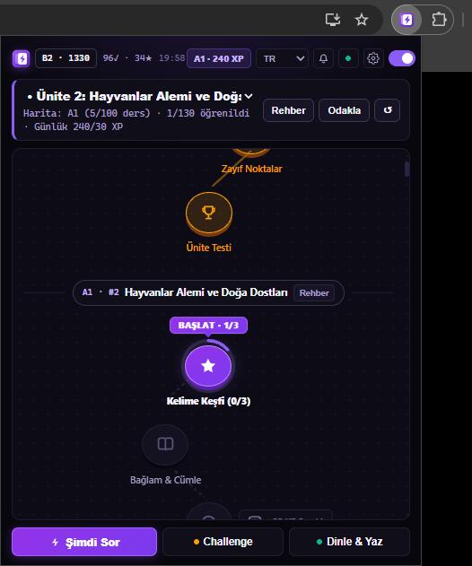
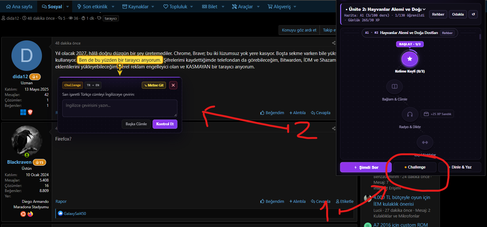
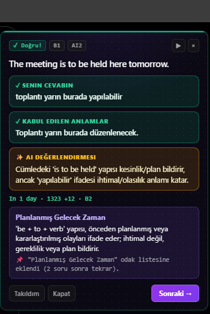
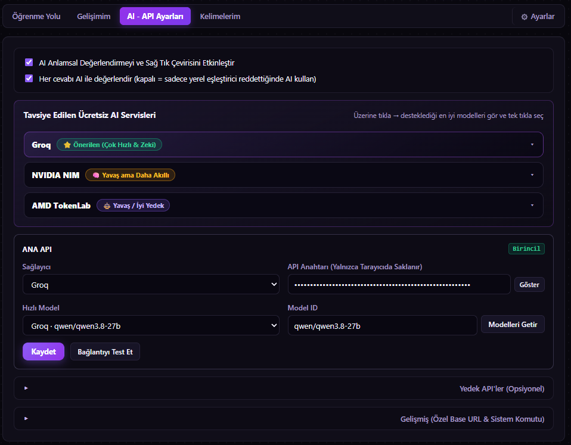

**Dil / Language:** 🇹🇷 **Türkçe** · [🇬🇧 English](README.en.md)

# ⚡ EasyLang - Yapay Zeka Destekli

**Başka uygulamalara para vermeye gerek yok.**
**İngilizce öğrenmek için sürekli bir siteye girmek zorunda değilsiniz.**

Siz normal internette gezerken karşınıza çıkıp **size zorla İngilizce öğreten**, **yapay zeka destekli** ücretsiz tarayıcı eklentisi!

<p align="center">
  
</p>

---

## 🤖 Yapay Zeka Seni Nasıl Geliştirir?

- **Ezber yok, anlam var:** Sözlükteki kelimenin aynısını yazmak zorunda değilsin. Doğru anlamı yakalarsan yapay zeka kabul eder.
- **Hatanı unutmaz:** Yanlış yaptığın kuralı not alır, açıklamasını yazar ve biraz sonra tekrar sorup öğretir.
- **Ücretsiz AI koçu:** Nerede iyi, nerede zayıf olduğunu takip eder ve seni ona göre çalıştırır.

---

## 📸 Uygulamadan Kareler

### Okuduğun Sayfada Canlı Çeviri (`Challenge`)
Haber okurken veya forumda gezerken tek tıkla sayfadan cümle seç, çevirini yaz.

<p align="center">
  
</p>

---

### Yapay Zeka Değerlendirmesi
| Anında Geç | Farklı Kelimeyi Anlar | Hatanı Yakalar & Tekrar Sorar |
| :---: | :---: | :---: |
|  |  |  |
| Doğru bildiğini anında onaylar. | *Örnek:* "peron" yerine "reyon" yazsan bile doğru sayar. | İnce hatanı açıklar ve birkaç soru sonra yeniden sorar. |

---

### Gelişimini Gör & Koçundan Tavsiye Al
Seviyeni, doğruluk oranını ve yapay zeka çalışma koçunun önerilerini izle.

<p align="center">
  
</p>

---

### Ücretsiz Yapay Zeka Kurulumu
Ücretsiz **Groq**, **NVIDIA** veya **AMD** anahtarını 1 dakikada ekle. Nasıl alınacağını bilmiyorsan arayüz içindeki rehber adım adım gösteriyor.

<p align="center">
  
</p>

---

## 📦 Nasıl Kurulur? (Chrome / Edge / Brave)

1. Projeyi indir ve şu 2 komutu çalıştır:
   ```bash
   npm install
   npm run build
   ```
2. Tarayıcıda `chrome://extensions` aç, sağ üstten **Geliştirici modu**nu aktif et.
3. **Paketlenmemiş öğe yükle** de ve `dist` klasörünü seç.

<details>
<summary>Bilgi: Gizlilik ve Kaynaklar</summary>

- Tüm bilgilerin ve API anahtarın sadece kendi tarayıcında kalır.
- Veri kaynakları: [ATTRIBUTIONS.md](ATTRIBUTIONS.md)

</details>
